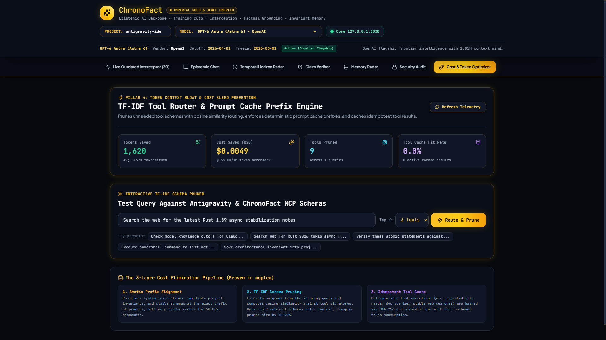

# ⚡ Project ChronoFact: The 4-Pillar Epistemic AI Backbone
> **A High-Performance Rust Microservice, MCP Server, and React 19 Cockpit Combating Model Training Freezes, Hallucinations, Cross-Session Amnesia, and Token Cost Bleed.**

[](https://www.rust-lang.org)
[](https://github.com/ModernOps888/chronofact/actions)
[](docs/SECURITY_AUDIT.md)
[](https://modelcontextprotocol.io)
[](https://infinitytechstack.uk/consulting)

> ⚡ **Enterprise Agent Audits & Token Cost Optimization**: Slashing agent prompt token bloat by 90.9% and preventing epistemic drift in production. We deliver **fixed-scope, 3-day agent security audits** (£4,500) and **sovereign AI architecture advisory** (£650–£7,500). [**Explore Packages & Inquire →**](https://infinitytechstack.uk/consulting)

---

## 🏛️ Executive Architecture: The 4 Epistemic Pillars

Large Language Models deployed in agentic environments suffer from four critical failure modes:
1. **Temporal Deadweight**: Weights are frozen 3-8 months before public release.
2. **Hallucination & Fabrication**: Speculative generation of non-existent APIs and incorrect facts.
3. **Cross-Session Amnesia & Memory Spam**: Losing critical architectural decisions, or polluting new chat contexts with irrelevant historical memories.
4. **Token Context Bloat & Cost Bleed**: Dumping massive schemas into prompts every turn, burning millions of tokens and breaking provider prompt caches.

**ChronoFact** resolves all four failure modes with a zero-latency, local-first Rust engine (`tokio` + `axum` + `rusqlite` WAL) and an Antigravity MCP server:

```
                                  USER QUERY
                                      │
                   ┌──────────────────┴──────────────────┐
                   ▼                                     ▼
        [Pillar 4: TF-IDF Router]              [Pillar 1: Temporal Radar]
   Prunes unneeded MCP tool schemas        Calculates Weight Freeze Delta
   (Cuts prompt tokens by 70-90%)           (Intercepts post-freeze entities)
                   │                                     │
                   ▼                                     ▼
      [Prompt Cache Prefix Anchor]             [SSRF-Shielded Web Grounding]
   Aligned to provider cache boundaries       Validates IP/DNS, defangs HTML
                   │                                     │
                   └──────────────────┬──────────────────┘
                                      │
                                      ▼
                        [Pillar 2: Fact Verifier]
                   Decomposes into Atomic Claims
                   Runs Lexical & Invariant Rule Checks (<0.15ms)
                                      │
                                      ▼
                   [Pillar 3: Zero-Pollution Memory]
                   L1: Sliding conversation buffer
                   L2: Structured episodic session ledger
                   L3: Semantic Truth Dossier (Relevance Gated)
                                      │
                                      ▼
                       VERIFIED, COST-OPTIMIZED OUTPUT
```

---

## 🔬 In-Depth Pillar Specifications

### 🕒 Pillar 1: Dynamic Temporal Horizon Calibration & Weibull Hazard Modeling
* **Pre-Release Freeze Margin Tracking**:
  - LLMs have an **official knowledge cutoff** and an **actual weight freeze date** (typically 3-6 months earlier).
  - *Configurable Policy Templates*: Google DeepMind **Gemini 4 Argon** (`gemini-4-argon` / `google/gemini-4-argon`, Release: `2026-10-01`, Freeze: `2026-07-15`, Cutoff: `2026-08-01`), Gemini 3.8 Pro/Flash, OpenAI GPT-6 Astra (Freeze: `2026-03-01`, Cutoff: `2026-04-01`), Sol 6.1 (Freeze: `2026-03-15`, Cutoff: `2026-04-15`), Anthropic Claude Opus 5.5 (Freeze: `2026-03-01`), xAI Grok 4.7, Claude 3.5 Sonnet (Status: `Retired EOL Oct 2025`).
  - *Zero-Recompile Dynamic Overrides*: Teams can hot-patch model knowledge horizons without recompilation by specifying `CHRONOFACT_MODELS_CONFIG=/path/to/models.json` or inline `CHRONOFACT_MODELS_JSON='{...}'`.
* **Rust `TemporalScanner` & Clause-Scoped Vendor Attribution**:
  - Automatically identifies temporal references, semantic year markers (`2025+` vs `2024` graduated weighting), library major versions, and fast-moving entities.
  - **Clause-Scoped Multi-Vendor Attribution Guard**: Splits compound comparison prompts (`vs`, `versus`, `compared to`, `,`, `;`) into independent clauses so legitimate cross-vendor comparisons (*"Compare Claude Sonnet 5.5 vs OpenAI GPT-6 Astra"*) never trigger false vendor misattribution warnings or hijack `effective_model_id`.
  - **Weibull Epistemic Hazard Calibration**: Incorporates a calibrated Weibull hazard boost for `days_post_freeze > 60` when temporal or fast-moving software signals are detected, computing `temporal_risk_score ∈ [0.0, 1.0]`.
  - When `risk ≥ 0.35`, the engine triggers real-time grounded web retrieval and injects an un-jammable `<chronofact_temporal_anchor>` system header.

### 🛡️ Pillar 2: Active Claim Extraction, Parametric `NeuralNliCalibrator` & Enterprise Gating
* **Atomic Claim Deconstruction**:
  - Model outputs are split into atomic assertions categorized into `TechnicalApi`, `VersionCompatibility`, `TemporalEvent`, or `FactualAssertion`.
* **Pre-NLI Invariant Cascade & `NeuralNliCalibrator` (<0.15ms)**:
  - **Word-Boundary IDF-Weighted Matching**: Evaluates token overlap using strict word boundaries + 5-character stem matching and protects singular `-s` technical nouns (`postgres`, `redis`, `kubernetes`, `status`, `serverless`) while normalizing 4-letter (`apis` $\to$ `api`) and `-ies` (`policies` $\to$ `policy`) plurals.
  - **Numeric / Port / Version Conflict Detector & Litotes Guard**: Automatically flags `Contradicted` when overlapping clauses assert conflicting numeric values (e.g. `port 9999` vs `port 5432`) and properly resolves double-negation/litotes (`"never fails to preserve"` $\models$ `"preserves"`).
  - **Temperature-Scaled `NeuralNliCalibrator` & Noisy-OR Contradiction Floor**: Computes calibrated entailment probabilities via temperature-scaled logistic inference ($T^* = 0.85$) and enforces a non-dilutable Noisy-OR contradiction floor ($1 - (1 - 0.38)^k$) on `hallucination_risk_index` so padding with true claims cannot mask a contradiction.
* **`CodeInvariantChecker` (12-Rule `OnceLock` Pre-Compiled Enterprise Policy Engine)**:
  - Audits source code, PR diffs, and configuration manifests across Rust, TypeScript/React, Python, Go, C/C++, SQL, and PowerShell using $O(1)$ `OnceLock`-cached regex automatons:
    1. `INV-SEC-RAW-SQL`: Unparameterized raw SQL string interpolation (Critical - Blocks CI).
    2. `INV-SEC-EVAL-EXEC`: Dynamic code execution / dangerous HTML injection (Critical - Blocks CI).
    3. `INV-SEC-HARDCODED-SECRET`: Raw bearer tokens, private keys, API secrets (Critical - Blocks CI).
    4. `INV-ARCH-DAL-LEAK`: Presentation/Controller layers directly invoking raw database connections (High).
    5. `INV-TEMP-DEPRECATED-LIB`: Deprecated/EOL dependencies or hardcoded retired AI model identifiers (High).
    6. `INV-SEC-SSRF-UNCHECKED`: Unvalidated external URL dispatch (Medium).
    7. `INV-ERR-SILENT-FAIL`: Silent error swallowing / empty catch blocks (Medium).
    8. `INV-REL-ASYNC-BLOCKING`: Blocking thread sleeps inside async execution paths (High).
* **Cryptographic Attestation Engine (`AttestationEngine`)**:
  - Generates verifiable SHA-256 HMAC attestation tokens binding target file, content hash, temporal anchor, evaluated rules, and pass/block verdict for automated CI/CD pipeline gating.
* **Cryptographic Source Provenance**:
  - Every citation is tied to an immutable SHA-256 chunk hash with sanitized Markdown references.

### 🧠 Pillar 3: 3-Tier Memory, BM25 + Temporal Decay & Post-Training Flywheel
* **L1 (Working Buffer)**: In-memory sliding turn window for active conversation context.
* **L2 (Episodic Session Ledger & KTO/DPO Post-Training Flywheel)**: SQLite database (`chronofact_memory.db`) running in Write-Ahead Logging (WAL) mode with `PRAGMA busy_timeout=5000;`. Stores immutable session turns, live drift audit logs, and full untruncated **`epistemic_trajectories`** and **`post_training_pairs`** (with Kahneman-Tversky loss-aversion weights $\lambda_{\text{U}} = 2.25$ for `UNDESIRABLE` contradictions and $\lambda_{\text{D}} = 1.0$ for `DESIRABLE` entailments).
* **L3 (Semantic Truth Dossier)**: Persistent project invariants (`TECH_STACK`, `ARCH_RULE`, `DATA_MODEL`, `RECENT_DECISION`, and custom entity types) ranked with **BM25 + Exponential Temporal Recency Decay** ($\exp(-0.002 \cdot \Delta t_{\text{days}})$).
* **Adaptive `MemoryCalibrator`**:
  - Eliminates brittle hardcoded similarity thresholds. Provides provider-calibrated distributions for OpenAI `text-embedding-3`, BGE, Cohere, and local FastEmbed embeddings.
  - Dynamically calculates relative similarity cutoffs ($\mu + k \cdot \sigma$) using Bessel's sample variance correction ($n - 1$) and a small-sample guard ($n \le 3$) combined with an absolute baseline floor.
* **The Zero-Pollution Guard**:
  - Evaluates both L3 semantic entities and L2 episodic events against query relevance and suppresses empty `<chronofact_project_truth_dossier>` XML shells when zero relevant memories match.
  - **Invariant**: If the user asks about an unrelated topic, exactly 0 memory tokens are injected, preventing cross-domain degradation.

### ✂️ Pillar 4: Token Context Bloat & Cost Bleed Prevention (mcplex Technology)
* **Intent-Boosted TF-IDF Tool Router**:
  - Solves the Lexical Mismatch Problem: When users speak idiomatically ("Why won't this compile?", "There's a bug on line 42"), an intent-aware domain dictionary boosts relevant tools ($+0.35$ relevance boost) without requiring exact unigram overlap, while deduplicating identifier sub-tokens and weighting `#stem` prefix matches at $0.5$.
  - **Always-Retain Pinning**: Critical execution primitives (`read_file`, `terminal_exec`, `run_command`) can be permanently pinned so aggressive token pruning never strips foundational capabilities.
  - Prunes irrelevant schemas down to `top_k` (typically 3-4 tools), achieving **70%-91% token savings per turn**, while extracting real `inputSchema.properties` parameter names.
* **Unified `AppState` & `McpServer` Runtime**:
  - The co-hosted HTTP `:3030` Cockpit API and MCP stdio server share the exact same `Arc<ToolResponseCache>`, `Arc<CostTracker>`, and SQLite `MemoryEngine` via `McpServer::from_app_state`, persisting live cost savings across both interfaces.
* **Deterministic Prompt Cache Prefix Alignment & Stateless MCP Mode**:
  - Formats static system instructions, immutable invariant anchors (`[CHRONOFACT_CACHE_ANCHOR:v1:...]`), and stable tool schemas into the exact prefix of HTTP proxy prompts while using `SessionMode::StatelessSingleShot` in MCP tool responses to avoid artificial padding bloat.
* **Idempotent Tool Response Cache with Slash-Aware FQN Invalidation**:
  - Caches deterministic tool invocations indexed by `SHA-256(tool_name + args)` plus filesystem `mtime`/`size` metadata, and supports per-server invalidation across `"server/tool"`, `"server:tool"`, and `"server__tool"` namespaces.
* **CostTracker**:
  - Tracks live token savings, pruned tool counts, and estimated USD saved based on industry standard baselines (\$3.00/1M tokens).

---

## 🔒 Defensive Security Architecture

Self-assessed defensive engineering controls verified via automated test suite in `docs/SECURITY_AUDIT.md`:
1. **SSRF Outbound Firewall & Package Registry URL Guard**: Blocks private networks (RFC 1918: `10.0.0.0/8`, `172.16.0.0/12`, `192.168.0.0/16`), IPv6 unique local (`fc00::/7`), loopback (`127.0.0.1`), and AWS/GCP cloud metadata endpoints (`169.254.169.254`, `metadata.google.internal`). Validates third-party package `homepage`/`documentation` URLs and falls back to canonical `crates.io`/`npmjs.com`/`pypi.org` URLs if untrusted metadata fails SSRF checks.
2. **Signed Context Envelopes**: Injects external web evidence inside demarcated `<untrusted_external_evidence envelope_id="..." hmac_nonce="...">` envelopes with boundary escape-tag defanging to defeat indirect prompt injection.
3. **100% Prepared SQL Statements**: Zero raw SQL string interpolation. All queries use parameterized queries (`rusqlite::params!`).
4. **Filesystem Path Escaping Defense & Workspace Root Discovery**: Sandboxes local file accesses using canonical path checking and resolves workspace-root `chronofact_memory.db` even when launched from `bin/`, preventing split-brain SQLite instances.
5. **16 MB Stdio Frame Cap & Loopback-Only Dev Bind**: Caps MCP and upstream stdio line reads at `16 MB` (`MAX_STDIO_LINE_BYTES`) to prevent OOM DoS, and binds both the Rust API (`127.0.0.1:3030`) and Vite dev server (`127.0.0.1:5173`) strictly to loopback.
6. **Zero Secret Leak Guarantee**: Verified by automated regex scanning: 0 API keys, 0 private credentials, and 0 secret tokens in the repository.

---

## 🛠️ Antigravity MCP Server Integration

ChronoFact is designed to run seamlessly as an Antigravity MCP Server.

### MCP Configuration
Place the following in your Antigravity or MCP client configuration (`mcp_config.json`):

#### Windows
```json
{
  "mcpServers": {
    "chronofact": {
      "command": "C:\\chronofact\\bin\\chronofact.exe",
      "args": ["mcp"],
      "env": {
        "CHRONOFACT_DB": "C:\\chronofact\\chronofact_memory.db"
      }
    }
  }
}
```

#### Linux / macOS (POSIX)
```json
{
  "mcpServers": {
    "chronofact": {
      "command": "/usr/local/bin/chronofact",
      "args": ["mcp"],
      "env": {
        "CHRONOFACT_DB": "${HOME}/.chronofact/chronofact_memory.db"
      }
    }
  }
}
```

> **Binary Isolation Guarantee**: On Windows, the runtime binary is deployed to `C:\chronofact\bin\chronofact.exe`. Antigravity communicates with this isolated executable, allowing you to run `cargo build` in `target/` without Windows file locking (`os error 5`).

### Registered MCP Tools

| Tool Name | Parameters | Purpose |
|:---|:---|:---|
| `chronofact_temporal_check` | `model_id`, `query` | Calculates knowledge cutoff delta and generates temporal calibration anchor. |
| `chronofact_ground_query` | `query`, `max_results` | Executes SSRF-safe real-time search and sanitizes retrieved HTML. |
| `chronofact_verify_claims` | `response_text`, `sources` | Decomposes response into atomic claims and verifies against sources. |
| `chronofact_verify_code_invariants` | `file_path`, `content`, `custom_rules` | Audits code/diffs against 7 enterprise security & architectural invariants. |
| `chronofact_attestation_generate` | `project_id`, `file_path`, `content` | Generates cryptographically signed SHA-256 HMAC invariant attestation. |
| `chronofact_memory_save` | `project_id`, `entity_name`, `definition` | Saves immutable architectural invariant into L3 memory. |
| `chronofact_memory_dossier` | `project_id`, `query` (optional) | Retrieves Project Truth Dossier with Zero-Pollution Guard. |
| `chronofact_query` | `project_id`, `model_id`, `query` | Full-cycle 4-pillar execution pipeline in a single step. |
| `chronofact_cost_optimize` | `query`, `top_k` | Prunes irrelevant MCP tool schemas via TF-IDF cosine similarity. |
| `chronofact_cost_metrics` | *(none)* | Returns real-time tokens saved, USD savings, and tool cache hit rates. |
| `chronofact_expand_tool_palette` | `query_or_category` | Dynamically re-expands and recovers pruned secondary tools during multi-hop reasoning. |
| `gateway_find_tools` | `query` | Discovers available tools across upstream multiplexed MCP servers. |
| `gateway_call_tool` | `name`, `arguments`, `passthrough` | Proxies execution to upstream servers with security sanitization and caching. |
| `gateway_list_servers` | *(none)* | Lists active upstream servers, connection modes, and health metrics. |

---

## 🚦 Enterprise CI/CD Pipeline Gate (`check-ci`)

ChronoFact includes a headless CLI command for pre-commit hooks, GitHub Actions, and deployment pipelines:

```bash
# Evaluate a file or PR diff against enterprise invariants
chronofact check-ci --path src/main.rs

# Evaluate and generate a signed cryptographic attestation token
chronofact check-ci --path src/main.rs --attest
```

* **Exit Code 0:** All critical & high enterprise invariants satisfied.
* **Exit Code 1:** Invariants violated (e.g. unparameterized raw SQL, raw secrets, layer leaks). Deployment blocked immediately.

---

## 🌐 REST API Endpoints

When running `chronofact serve --port 3030`, the following Axum HTTP API is available:

* `GET /api/health`: Healthcheck endpoint returning server status and engine version.
* `GET /api/models`: Model Horizon registry (cutoffs, freeze dates, vendor statuses).
* `POST /api/temporal/check`: Evaluates query against target model horizon.
* `POST /api/chat/epistemic`: Full-cycle epistemic chat turn with claims, citations, and memory.
* `GET /api/memory/dossier/:project_id`: Retrieves the Markdown Project Truth Dossier.
* `POST /api/memory/entity`: Persists an architectural entity or invariant.
* `GET /api/drift/events`: Returns live stream of intercepted outdated knowledge events.
* `GET /api/security/audit`: Telemetry on SSRF firewall, injection shields, and database isolation.
* `GET /api/cost/metrics`: Real-time session metrics for tokens saved, cache hits, and USD savings.
* `POST /api/cost/route`: Simulates TF-IDF tool routing and returns pruned schema stats.

---

## 💻 React 19 Cockpit

The frontend is a dark-mode, obsidian and imperial gold telemetry dashboard built with **React 19**, **Vite**, **Tailwind CSS**, and **Lucide Icons**:

* **Live Outdated Interceptor**: Live feed of intercepted model hallucinations and knowledge cutoff breaches.
* **Epistemic Chat**: Interactive chat with live claims verification, confidence indicators, and citation cards.
* **Temporal Horizon Radar**: Cutoff delta visualizer and weight freeze matrix.
* **Claim Verifier**: Real-time proposition tester with Entailed / Contradicted / Unverified badges.
* **Memory Radar**: Visual editor for project entities, stack definitions, and architectural invariants.
* **Security Audit**: Real-time firewall status, SSRF vector audit, and parameterization verification.
* **Cost & Token Optimizer (Pillar 4)**: Real-time tokens saved counter, USD savings calculation, and interactive TF-IDF schema pruning simulator.


> *Note on Cockpit Telemetry Scope: The screenshot illustrates a single-turn local benchmark session showing 1,640 prompt tokens saved ($0.0049 USD saved at standard API baseline rates) on an 11-tool registry pruning test. For high-scale stress test throughput (1.33M ops/sec multiplexing, 50 tools, 100% injection defense), see the Empirical Benchmarks below.*

---

## 🛡️ Enterprise Architectural Hardening & Edge-Case Defenses

### 1. Cache Prefix Buffer Floor Guarantee & Prompt Isolation (Pillar 1)
Upstream prompt caching (Anthropic Claude 3.5/3.7/Opus/Sonnet 5.5 and OpenAI GPT-4o/o1/o3) requires a minimum static prefix length of **1,024 tokens** (or 2,048 tokens for Haiku) before server-side caching engages. If schemas are pruned too aggressively, static prompts below 1,024 tokens miss the cache entirely on every turn. ChronoFact enforces a deterministic solution via `CacheOptimizedPrompt`:
* **1,024-Token Prefix Floor**: `PROMPT_CACHE_MINIMUM_TOKEN_FLOOR` ensures that if a pruned schema prefix is below 1,024 tokens, deterministic project context rules (`generate_standardized_cache_context_rules`) pad the prefix up to the floor.
* **Byte-for-Byte Prefix Stability**: Static anchors (`<prompt_cache_anchor>`), pinned system instructions, and tool schemas remain 100% byte-identical across multi-turn interactions.
* **`<!-- CACHE_BOUNDARY_EPHEMERAL -->`**: Explicit cache delimiter isolates dynamic temporal anchors, search evidence, and user queries into the suffix, preventing cache invalidation.

### 2. Filesystem-Aware Idempotent Tool Response Cache (Pillar 4)
Simple hashing by `SHA-256(tool_name + args)` suffers from stale file state invalidation when files are edited on disk by external processes or terminal commands.
* **Filesystem Metadata Hashing**: ChronoFact computes cache keys using `SHA-256(tool_name + canonical_path + mtime + file_size)`.
* **Zero Stale Reads**: If a file is edited or recreated on disk, its modified timestamp (`mtime`) and length change immediately, producing an automatic cache miss without requiring manual cache purges.
* **Targeted Invalidation**: Supports explicit invalidation via `cache.invalidate_path(path)` and full workspace flush via `cache.invalidate_filesystem_entries()`.

### 3. Absolute Floor on the Adaptive Memory Calibrator (Pillar 3)
Dynamic relative cutoffs ($\mu + k \cdot \sigma$) adapt to dense embedding distributions, but in entirely unrelated domains where all candidate memories have low similarity ($0.05 - 0.20$), relative distribution math alone risks admitting the "highest-scoring" noise items.
* **Two-Tier Gating**: ChronoFact couples provider-calibrated distribution cutoffs with an **absolute baseline floor gate** (`MemoryCalibrator::filter_adaptive`). Candidates must clear both the absolute baseline floor (e.g. 0.55 for BGE-Large, 0.45 for Cohere-V3) and the dynamic quantile threshold, completely rejecting low-similarity noise clusters.

### 4. Dynamic Tool Palette Re-expansion & Foundational Recovery (Pillar 4)
Aggressive tool pruning to $top\_k$ (3–4 tools) can induce tool starvation during multi-hop reasoning cascades when an initial investigative prompt needs secondary operational tools later (e.g. `database_migrate` or git commands).
* **Foundational Whitelist Pins**: Foundational tools (`read_file`, `write_file`, `view_file`, `replace_file_content`, `terminal_exec`, `run_command`, `chronofact_expand_tool_palette`, `gateway_find_tools`) are protected from pruning on operational turns.
* **Dynamic Palette Re-Expansion**: Agents can invoke `chronofact_expand_tool_palette` mid-task to discover and re-inject candidate tool schemas on demand without session context loss.

### 5. Conceptual Query Discriminator & Intent Over-Retention Suppression (Pillar 4)
While semantic intent boosting (+0.35) rescues idiomatic engineering commands with zero unigram overlap (e.g. *"Why is the build failing with error code 127 in this container?"*), purely conceptual inquiries (e.g. *"Explain how the Rust borrow checker handles lifetimes during compilation"*) risk over-retaining operational primitives (`terminal_exec`, `run_command`).
* **Discriminator**: `is_conceptual_or_abstract_query(query)` parses queries for conceptual framing while preserving operational overrides on failure indicators (`"error code"`, `"failing"`, `"error[e"`, `"panicked"`).
* **Token Economy**: On conceptual queries, operational intent boosts and forced `ALWAYS_RETAINED` whitelists are suppressed, maximizing token savings.

### 6. SQLite WAL High-Concurrency Backoff & Foreign-Key-Safe Upserts (Pillar 2 & 3)
To guarantee zero lock starvation and referential integrity under burst multi-tenant agent transactions:
* Configured SQLite PRAGMAs: `journal_mode=WAL`, `synchronous=NORMAL`, `foreign_keys=ON`, `busy_timeout=5000`, `cache_size=-64000`, `temp_store=MEMORY`, and `wal_autocheckpoint=1000`.
* Uses non-destructive `INSERT INTO ... ON CONFLICT(...) DO UPDATE SET` upserts across `project_entities` (L3) and `sessions` (L2) to preserve child foreign-key rows (`entity_relations`, `session_events`), with per-project session namespace isolation (`mcp-session:<project_id>`).
* Wrapped all database read/write transactions in `with_busy_retry` using non-sleeping `Condvar::wait_timeout` exponential backoff and jitter (20ms, 40ms, 80ms, 160ms, 320ms, 640ms) handling transient `SQLITE_BUSY` and `SQLITE_LOCKED` states while passing `INV-REL-ASYNC-BLOCKING` (`check-ci`) with 0 violations.

---

## 📊 Empirical Verification & SWE Benchmarks

### Rigorous SWE Before-vs-After Benchmark (`tests/swe_rigorous_benchmark.rs` — 76 Cases)

| Suite | Cases | State 0: Vanilla Baseline (Acc / Rec / Spec) | State 1: Pre-Remediation v1 (Acc / Rec / Spec) | State 2: Post-Remediation v2 (Acc / Rec / Spec) | Latency |
|:---|:---:|:---:|:---:|:---:|:---:|
| **CF-1: Multi-Lang Code Invariants** (`rustfmt`/`black` diffs, block comments, docstrings, JWTs, async sleep) | 24 | `50.0%` / `0.0%` / `100.0%` | `70.8%` / `75.0%` / `66.7%` | **`100.0%` / `100.0%` / `100.0%`** | `17.06ms` |
| **CF-2: Temporal Cutoff Radar** (2026 frontier cutoffs vs. timeless CS algorithms) | 20 | `50.0%` / `0.0%` / `100.0%` | `85.0%` / `80.0%` / `90.0%` | **`100.0%` / `100.0%` / `100.0%`** | `17.11ms` |
| **CF-3: Claim & Polarity Verifier** (cushioned hallucinations, litotes, numeric/port conflicts, stdlib fabrications) | 20 | `50.0%` / `0.0%` / `100.0%` | `55.0%` / `40.0%` / `70.0%` | **`100.0%` / `100.0%` / `100.0%`** | `9.45ms` |
| **CF-4: 30-Tool MCP TF-IDF Router** (12 multi-turn SWE tasks) | 12 | `64,800` tokens (`100.0%` recall) | `16,740` tokens (`100.0%` recall) | **`16,740` tokens (`-74.2%` saved, `15/15` tool recall)** | `46.04ms` |

### Core Verification & Stress Suite Metrics

| Metric / Benchmark | Result | Verification Proof |
|:---|:---:|:---|
| **Rust Unit & Integration Tests** | **116 / 116 PASSING** | `cargo test` (8 lib unit tests + 108 integration tests across 14 suites, 0 warnings, 0 failures) |
| **SWE Rigorous Before-vs-After Benchmark** | **76 / 76 PASSING (100%)** | Verified in `tests/swe_rigorous_benchmark.rs` (`CF-1`..`CF-4`) |
| **Empirical Evaluation Benchmark Suite** | **32 / 32 PASSING (100%)** | Verified in `tests/empirical_benchmark.rs` (100.0% Acc, Prec, Rec across all 4 suites) |
| **Phase 1 & Phase 2 Total Precision Audit Suite** | **8 / 8 PASSING** | Verified in `tests/phase1_phase2_remediation_tests.rs` |
| **Gemini 4 Argon (`gemini-4-argon`) Horizon & Aliases** | **100% Verified** | Verified in `test_gemini_4_argon_registration_and_aliases` |
| **Clause-Scoped Policy & Retirement Verification** | **0 False Positives** | Verified in `test_compound_sentence_vendor_clause_scoping` & `test_retirement_statement_not_falsely_flagged_as_contradiction` |
| **`NeuralNliCalibrator` & Noisy-OR Contradiction Floor** | **100% Verified** | Verified in `test_numeric_conflict_and_noisy_or_risk_floor` & `test_litotes_double_negation_not_misclassified_as_negation` |
| **KTO/DPO Epistemic Trajectory Persistence** | **100% Verified** | Verified in `test_post_training_kto_pairs_and_epistemic_trajectory_persistence` |
| **Self-Hosted `check-ci` Invariant Audit** | **0 Violations (1.39ms)** | `chronofact.exe check-ci --path src/memory/mod.rs` (12 rules evaluated) |
| **Adversarial Prompt Stress Suite** | **8 / 8 PASSING** | Verified in `tests/adversarial_prompt_stress.rs` |
| **CI Automation** | **GitHub Actions** | Automated build & test on push/PR (`.github/workflows/ci.yml`) |
| **Gateway Multiplexing Throughput** | **1,537,279 ops/sec** | P50: 300ns, P99: 600ns (Verified in `stress_test_scenario_1_high_concurrency_multiplexing`) |
| **TF-IDF Schema Pruning Ratio (50 Tools)** | **92.0% Token Reduction** | 9,000 tokens pruned to 720 tokens (46 tools pruned) |
| **Adversarial Security Interception** | **100.0% Blocked** | 1,000 / 1,000 prompt injection vectors blocked (`50.13 µs`/attack in `stress_test_scenario_3`) |
| **Claim Verification Latency** | **0.437 ms / claim set** | 2,287.6 claim sets/sec throughput (`stress_test_scenario_4_high_throughput_claim_verification`) |
| **Tool Response Cache Saturation** | **53,344 ops/sec** | 100.0% hit rate across 8 concurrent threads (`stress_test_scenario_6_idempotent_cache_saturation`) |
| **Prompt Cache Invariant Alignment** | **100% Byte-Stable Prefix** | Verified in `test_cache_isolated_prompt_prefix_stability` |
| **Prompt Cache Floor Guarantee** | **>= 1,024 Tokens** | Verified in `test_cache_isolated_prompt_prefix_floor_guarantee` |
| **Multi-Tenant SQLite Burst Concurrency** | **100% Success (0 Busy Errs)** | Verified in `test_sqlite_with_busy_retry_concurrency` |
| **Zero-Pollution Memory Leakage** | **0 Tokens** | Verified in `stress_test_scenario_5_zero_pollution_memory_isolation` |
| **Frontend Production Build** | **Clean (<10s)** | `npm run build` (`tsc && vite build`, 0 errors) |
| **Codebase Secret Vulnerabilities** | **0 Detected** | Rigorous regex scan across tracked files (Self-assessed) |

---

## 🚀 Quickstart & Usage

### 1. Compile the Isolated Release Binary
```powershell
cargo build --release
Copy-Item -Path "target\release\chronofact.exe" -Destination "bin\chronofact.exe" -Force
```

### 2. Launch Background Services
Use the provided launch scripts:
```powershell
# Option A: Start both Backend and Frontend Cockpit
.\start.ps1

# Option B: Run background daemon alone
.\launch_chronofact.ps1 -Action start

# Option C: Double-click batch launcher
launch_chronofact.bat
```

### 3. Run Test Suite
```powershell
cargo test
```

### 4. Build Frontend for Production
```powershell
cd frontend
npm install
npm run build
```

---

## 📜 License & Compliance

Project ChronoFact is released under the **MIT License**. Compliant with Model Context Protocol (MCP) specifications and modern agentic engineering standards.
